Evidence

This folder contains screenshots documenting my SIEM log analysis investigation using Splunk Enterprise and sample web access logs.

## 1. Data Ingestion and Validation

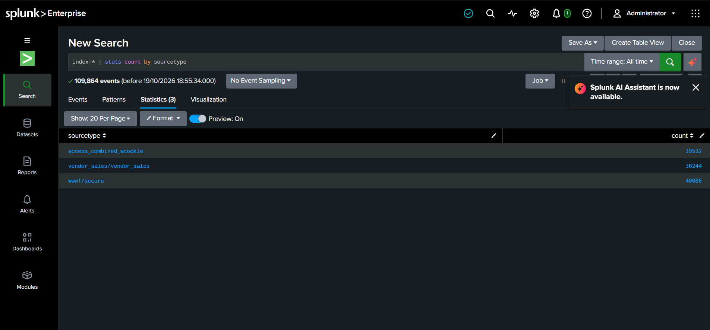

## 2. Error Event Analysis

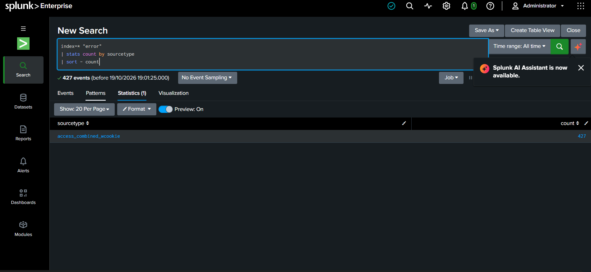

## 3. Event Field Investigation

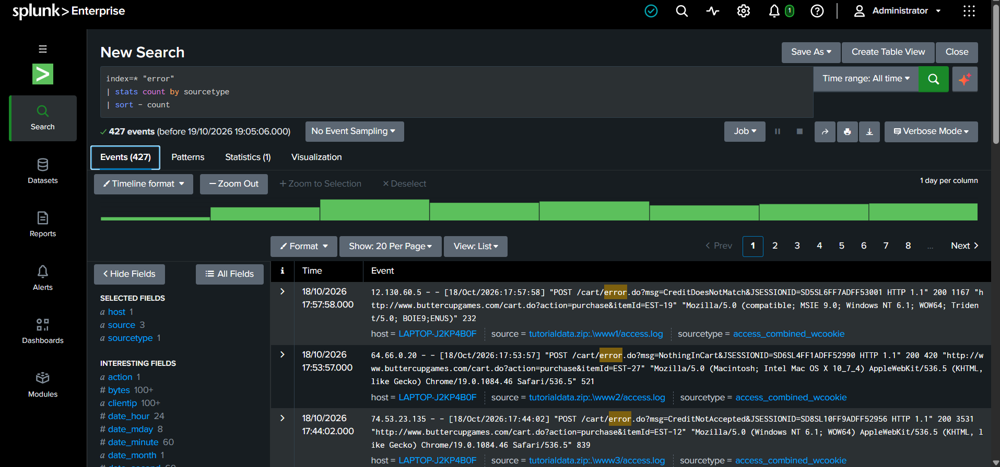

## 4. Error Path Statistics

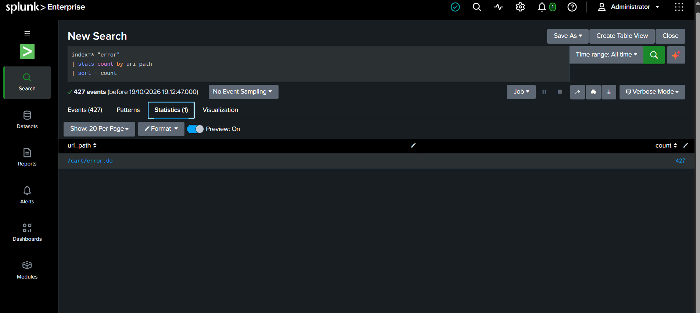

## 5. Raw Error Events

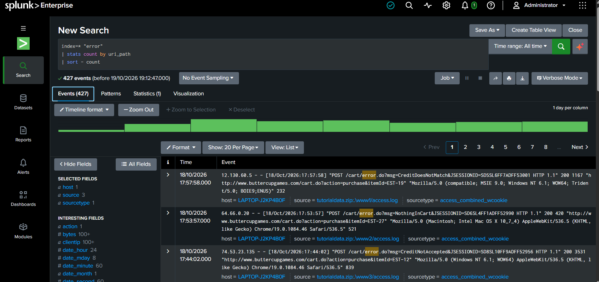

## 6. Hourly Error Trend

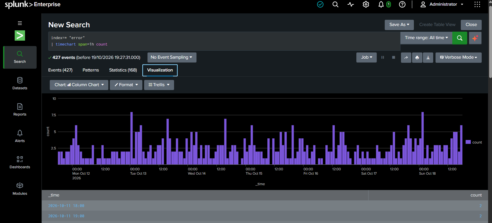

## 7. Error Counts by Client IP

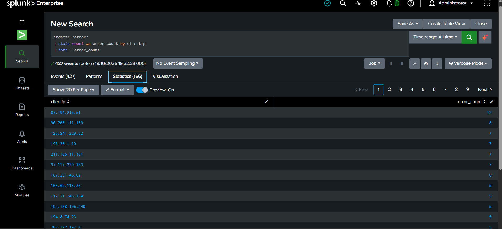

## 8. Error Counts by Client IP Chart

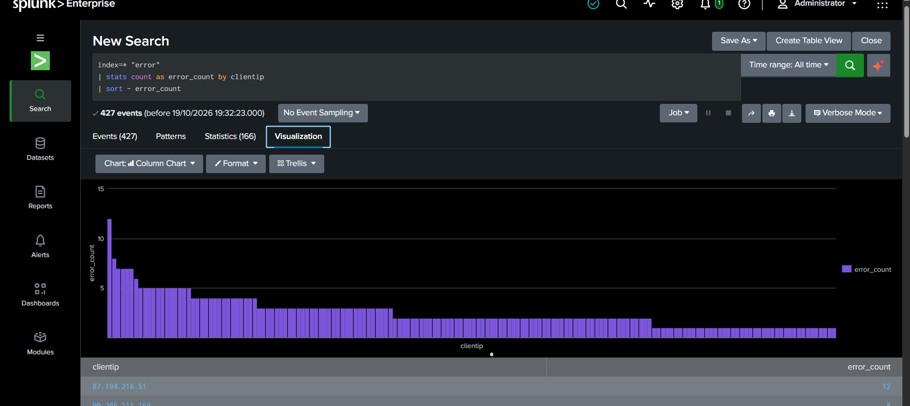

## 9. Client IP Event Investigation

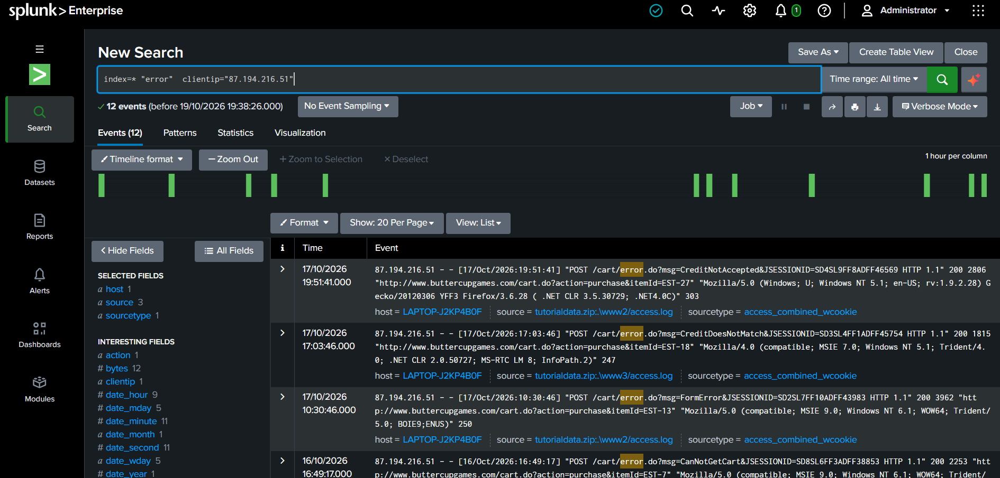

## 10. Expanded Web Log Event

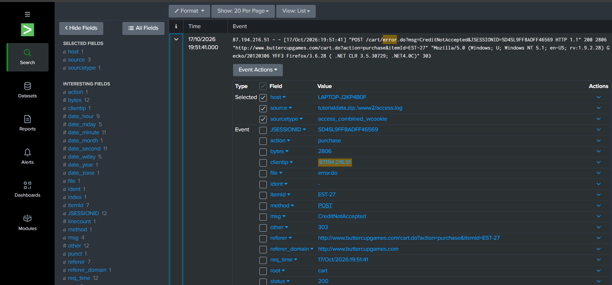

## 11. IP Activity by Action

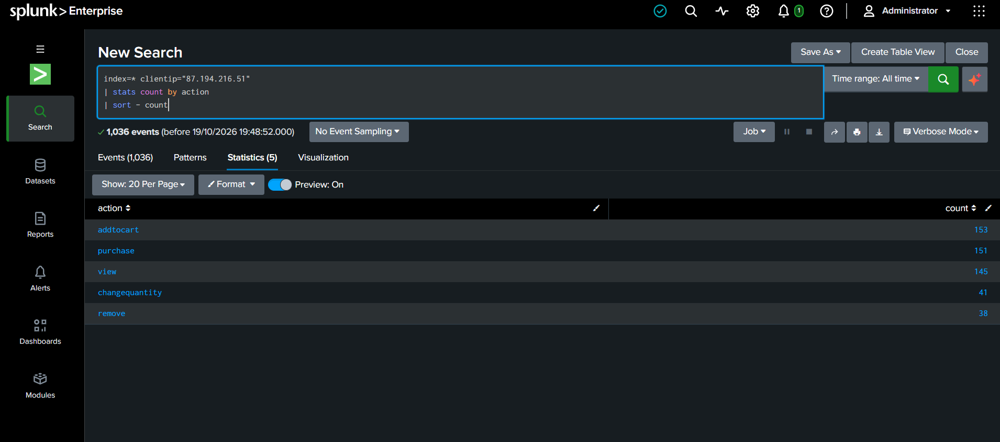

## 12. IP Event Investigation

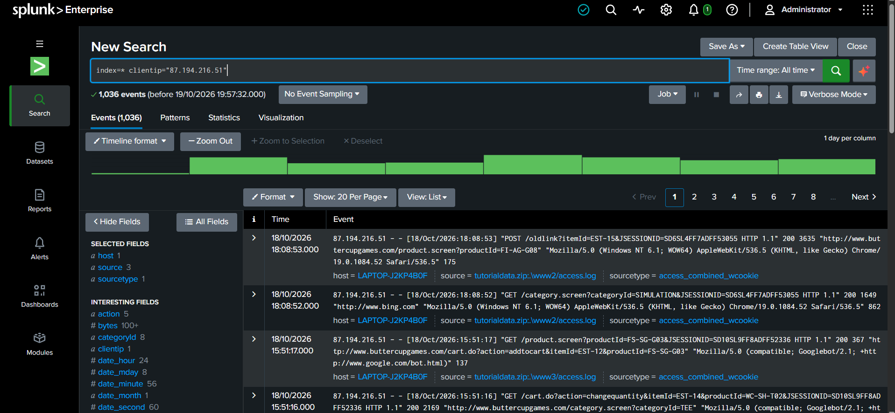

## 13. IP URL Path Analysis

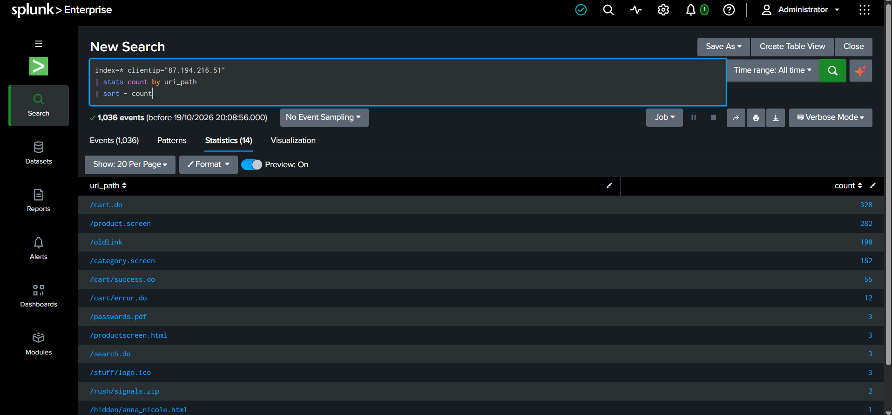

## 14. Passwords PDF Requests

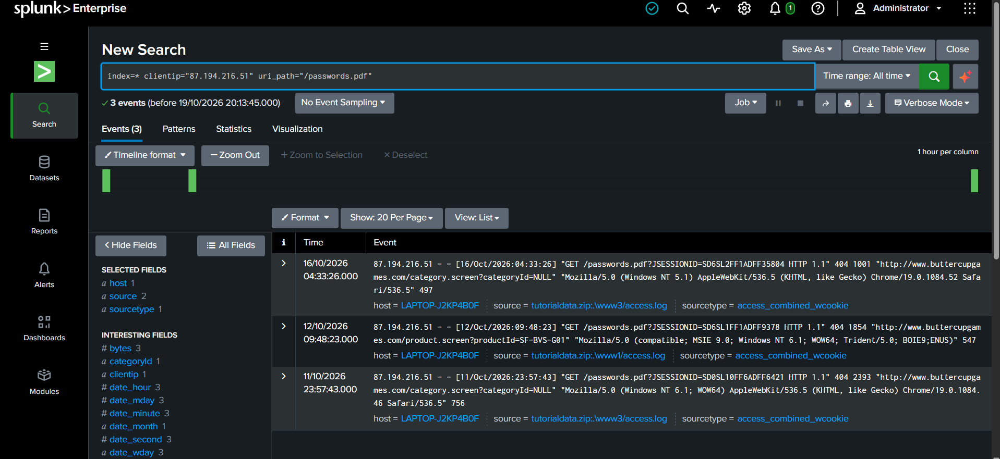

## 15. Passwords PDF Event Details

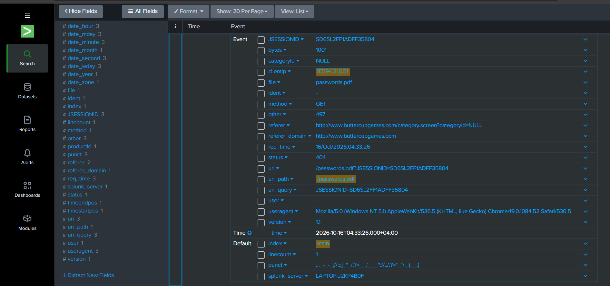

---

*Note: These screenshots document analysis of sample training data. The observations do not, by themselves, confirm a real cyberattack.*
